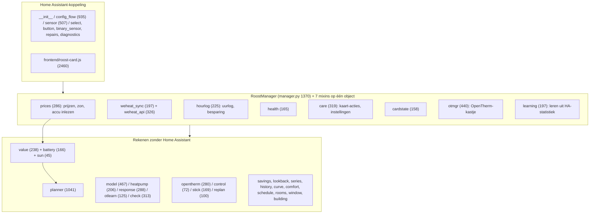

# Architectuur van Roost — kaart (22-11-2026)

Gemeten op commit 6c2ec34 (`custom_components/roost`, 54 bestanden, ~12.000 regels Python + een kaart van 2.460 regels).

## De lagen zoals ze nu zijn

- **Puur rekenen** (geen import van `homeassistant`): planner, de modellen, OpenTherm-beslissingen, energie (value/battery/sun), besparing.
  Dat deel is goed testbaar en wordt ook door de simulatie (`tools/sim`) gebruikt.
- **De manager** is één klasse met **zeven mixins** (`PricesMixin, WeheatMixin, HourLogMixin, HealthMixin, CareMixin,
  CardMixin, OpenThermMixin`). Ze delen allemaal hetzelfde `self`.

## Waar de wirwar zit

Gemeten: welk deel attributen of methoden van een ander deel gebruikt.

| Deel | Methoden | Leest toestand van andere delen | Roept methoden van andere delen |
|---|---|---|---|
| manager | 50 | 1 | 32 |
| hourlog | 10 | **26** | 14 |
| otmgr | 22 | 15 | 16 |
| health | 10 | 12 | 13 |
| care | 11 | 9 | 9 |
| cardstate | 12 | 9 | 8 |
| prices | 8 | 7 | 7 |
| weheat_sync | 6 | 7 | 7 |

- **127 attributen** gedeelde toestand op één object. Het meest gedeeld zijn `hass, ent, mem, mode, entry, pump, plan, window, _weather, check`.
- Een wijziging in bijvoorbeeld `plan` of `pump` raakt dus ongemerkt vier of meer bestanden. Daar kwamen deze week ook de lastigste fouten vandaan: de herstart-vlag, de meter van de binnenunit, de volgorde van de meterstanden in een test.
- `learning.py` importeert `manager` terug (een kring).

**Wat al goed is:** de route van energie. `prices._energy` leest HA in, en daarna is alles puur:
`value.EnergyInputs` → `value.compute` → `value.planner_prices` → `HourPrices(p_grid, p_own, own_kw)` → `planner.HourIn`.
Het accumodel (`battery.BatteryHabits`) en de zon (`pv_k`, de zonverwachting) komen alleen via die inputs binnen.

## Doelindeling

| Module | Doet | Uitkomst (de koppeling) |
|---|---|---|
| **energie** | prijzen, eigen zon, accu | per uur: netprijs, waarde eigen stroom, eigen kW. Met een aan/uit per bron (meetbaar) |
| **planner** | het plan (thermostaat of OpenTherm) | uren met stand en reden (bestaat al) |
| **leren** | huis, warmtepomp, binnenunit, OpenTherm | modellen als data, met één `learn(rows)` per model |
| **sturing** | thermostaat of OpenTherm-kastje: van plan naar opdracht | wat er nu geschreven wordt (bestaat al grotendeels: `control`, `opentherm`) |
| **meten** | uurlog, besparing, controle | getallen voor de kaart (`hourlog`, `savings`, `check`) |
| **HA** | inlezen, schrijven, sensoren, kaart, meldingen | dunne laag; de enige plek die `hass` kent |

De regel: **alleen de HA-laag kent `hass`**. Een module krijgt wat hij nodig heeft als argument mee en geeft een resultaat terug, in plaats van in `self` van een ander deel te lezen of te schrijven.

## Stappen (elk apart te testen)

1. **energie**: maak van `prices._energy` een dunne inleeslaag en zet de rest in `energy/` (`value`, `battery`, `sun`, de zonverwachting), met één functie `hour_prices(inputs) -> list[HourPrices]` en een aan/uit per bron.
   *Rechter:* de regress-simulatie geeft exact dezelfde getallen en alle tests slagen.
   Daarna is "wat levert de accu echt op" meetbaar op echte data.
2. **meten**: `hourlog` krijgt een klein object (plan, uur, meters) mee in plaats van 26 attributen te lezen.
3. **OpenTherm**: `otmgr` wordt een eigen klasse met zijn eigen toestand (`ot_mem`, `ot_obs`, `ot_learned`) in plaats van een mixin.
4. **care / cardstate / health**: idem; de kaart leest één samengevatte toestand.
5. **leren**: de kring `learning → manager` weg; leren krijgt rijen en geeft modellen terug.

Per stap: dezelfde simulatie-uitkomst, alle tests groen, één commit. Pas daarna de volgende stap.

## Na de ombouw naar kern en schil (24-11-2026)

De negen mixins en `mgr_base.py` zijn weg. Twee lagen:

- **Kern** (`custom_components/roost/core/`, geen `homeassistant`; `tests/test_core.py` draait zonder HA en controleert dat):
  kleine bevroren bundels met pure functies die een nieuwe bundel teruggeven.

  | Module | Bundel | Doet |
  |---|---|---|
  | `core/meters.py` | `Meters` | warmte in de vloer, stroom en kosten vandaag (ook binnenunit), runs, ontdooien |
  | `core/weather.py` | `Weather` | verwachting, geschiedenis voor het leren, heldere-hemel-straling |
  | `core/prices.py` | `Prices` | gepubliceerde prijzen, day-ahead-formule, sensor zonder verwachting, vast contract, zon, vlakke terugval |
  | `core/weheat.py` | `Weheat` | uren van de pomp, laatste aanroepen, instellingen, import-voortgang |
  | `core/hourlog.py` | `Logs`, `HourAcc` | uur-log, plan-log, voorspellingen, dagcijfers, het lopende uur |
  | `core/plan.py` | `Held` | het plan in kracht; invoer van de planner (`hours_ahead`, `rooms_ahead`); plan per uur; mislukte ronde en terugval |
  | `core/card.py` | `CardState` | wat de kaart naast het plan toont, en wanneer Weheat gevraagd wordt |

- **Schil**: `manager.py` (levensloop, opslaan, de tick, plannen, sturen) en de delen die hij vasthoudt:
  `m.read` (reader.py), `m.otc` (otmgr.py), `m.wh` (weheat_sync.py), `m.hl` (hourlog.py), `m.notices` (health.py),
  `m.care` (care.py), `m.card` (cardstate.py), `m.learner` (learner.py); `prices.py` en `weatherfetch.py` zijn gewone
  functies. Elk deel krijgt de manager als host (getypt) en kent geen andere delen dan via de host.

Regel in de schil: **een bundel nooit over een `await` vasthouden.** Wat binnenkomt (verwachting, day-ahead, maanden van
Weheat) gaat in de bundel zoals die dán is, zodat een tick of het leren dat intussen liep niets kwijtraakt.

Opgeslagen sleutels zijn ongewijzigd. Niet gedaan: een `DataUpdateCoordinator` (verandert wanneer de tick loopt en maakt
entiteiten onbeschikbaar bij een mislukte ronde).
